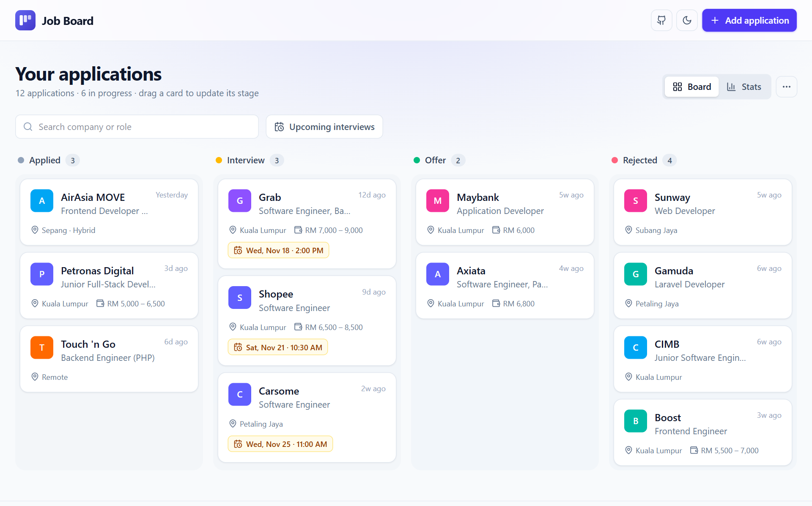
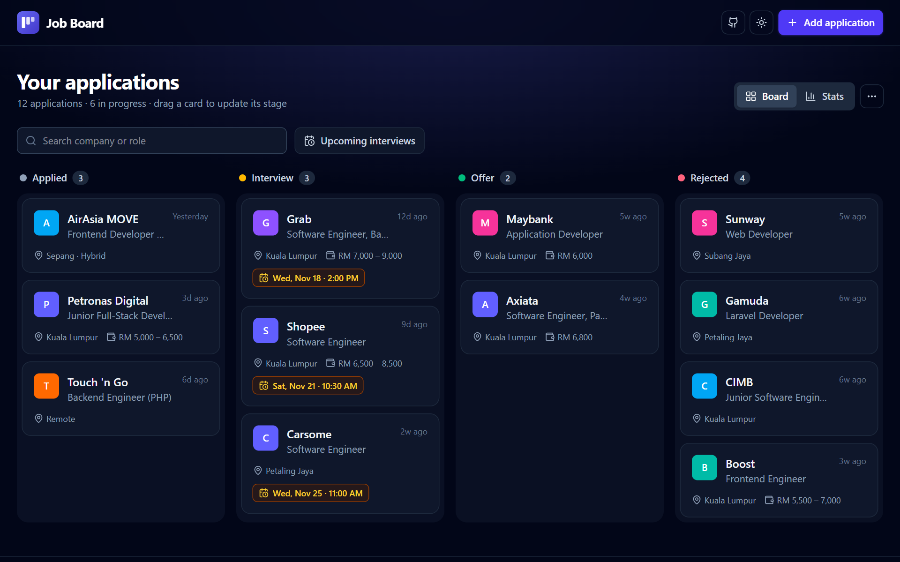
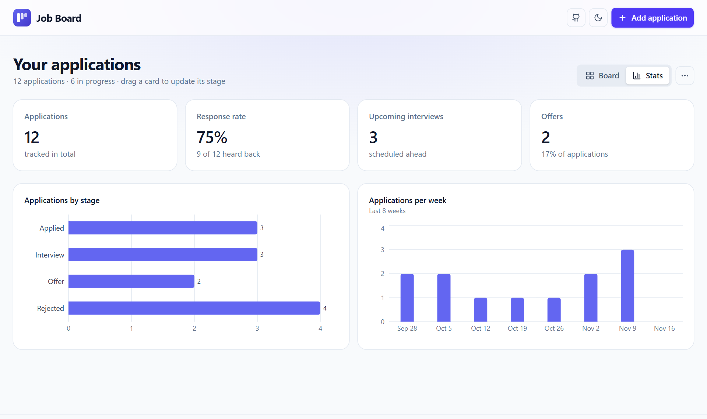
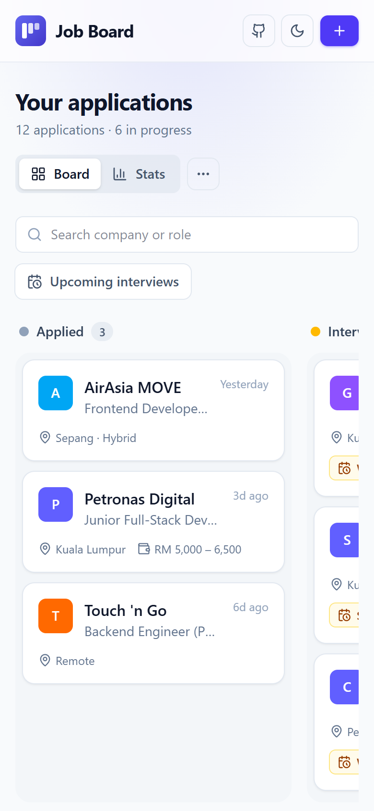

# Job Board

A Kanban board for tracking job applications. Drag a card from **Applied** to **Interview**, **Offer** or **Rejected**, search and filter as you type, and see how your job hunt is going on a stats page.

**Live demo: [job-board-five-navy.vercel.app](https://job-board-five-navy.vercel.app)** (opens with sample data, no sign-up needed)

> **A learning project: my first React app, built with AI assistance.**
> I wanted to learn a new framework and, for the first time, focus only on the front end. My background is Laravel, so I rebuilt the idea of my Laravel project, [job-tracker](https://github.com/kishorekannan25/job-tracker), in React and TypeScript.
> As I was new to React, I relied on an AI assistant ([Claude Code](https://claude.com/claude-code)) for most of the guidance and code. I typed many of the features myself, step by step, and I reviewed and tested everything before shipping. See [How it was built](#how-it-was-built) for exactly who did what.



## Features

- **Drag and drop** cards between columns and reorder them within a column. Works with a mouse, and on touch screens with press and hold (a normal swipe still scrolls the page).
- **Add, edit and delete** applications in a pop-up form: company, role, status, applied date, interview date and time, salary, location and notes.
- **Instant search** by company or role, plus an **Upcoming interviews** filter.
- **Stats view** with summary tiles (response rate, upcoming interviews, offers) and two charts: applications by stage, and applications per week.
- **Dark mode** that follows your system setting on a first visit and remembers your choice, with no white flash on load.
- **Export and import** your data as a JSON backup file, from the ⋯ menu. Imported files are checked before anything is replaced.
- **Saved in your browser.** No account and no server: your changes stay on your device. On a first visit the board fills with sample data, and "Reset demo data" in the ⋯ menu brings it back.
- **Responsive.** Four columns on a laptop; on phones and tablets the columns scroll sideways.
- **Helpful empty states**, for an empty board and for a search with no results, plus a welcome tip for first-time visitors that hides after their first click.
- **Small animations**: cards lift on hover, pop-ups and menus pop in, and views fade in. They switch off for people who turn on "reduce motion".

| Dark mode | Stats | Phone |
| --- | --- | --- |
|  |  |  |

## Tech stack

| Tool | Used for |
| --- | --- |
| [React 19](https://react.dev) + [TypeScript](https://www.typescriptlang.org) | The UI |
| [Vite](https://vite.dev) | Dev server and build |
| [Tailwind CSS 4](https://tailwindcss.com) | Styling and dark mode |
| [dnd kit](https://dndkit.com) | Drag and drop |
| [Recharts](https://recharts.org) | Charts (loaded only when the stats view is opened) |
| [Lucide](https://lucide.dev) | Icons |
| `localStorage` | Saving data in the browser |

It is a front-end only app: there is no backend or database, so it can be hosted for free as static files.

## How it was built

This was my first time working in React and TypeScript, so I needed a lot of help, and I want to be clear about where it came from.

- **Features I typed myself, with Claude guiding me.** Claude explained one small step at a time (which file, what code, and what it does, often compared to the Laravel equivalent). I typed it, and Claude checked my code with the TypeScript build and the linter. Built this way:
  - adding, editing and deleting applications
  - search and filter
  - the stats view
  - the dark mode logic
  - export and import
  - the empty states
- **Code Claude wrote directly:**
  - the project setup
  - the first version of the board with drag and drop
  - the dark mode colours across the components
  - the later fixes for phones, tablets and loading speed
  - the final redesign (top bar, ⋯ menu, footer and animations) and the welcome tip, after I said the app still looked more like a tool than a website
- **What I did throughout:** decided what to build next, tested every feature in the browser, and decided whether it was good enough before moving on. Every feature was also checked in a headless Chrome browser, including phone-sized screens.

### Mistakes I made and learned from

- Closed an `onSubmit={() => { ... }}` handler with `)}` instead of `}}`, which taught me how JSX braces and function braces nest.
- Wrote a template string with single quotes instead of backticks, so `${h}:${min}` was shown as plain text instead of the time.
- Misspelled a state setter (`setUpComingOnly` instead of `setUpcomingOnly`). JavaScript names are case-sensitive.
- Pasted one button inside another by accident. A button inside a button is invalid HTML, and React warns about it.
- Added a new function to a hook but forgot to return it, so the component could not use it.
- Used an icon without importing it.

## Companion project

This is the front-end companion to [job-tracker](https://github.com/kishorekannan25/job-tracker), the same idea built in **Laravel**: database, authentication, authorization policies, a REST API with Sanctum, tests and CI. I built that one to learn the backend properly, then rebuilt the experience in React for a modern UI.

## Run it locally

You need [Node.js](https://nodejs.org) 18 or newer.

```bash
npm install
npm run dev      # starts the app at http://localhost:5173
npm run build    # type-checks and builds to dist/
npm run lint     # checks the code with ESLint
```

## Project structure

```
src/
  App.tsx                 page layout, search and filter, Board / Stats switch, pop-ups
  components/
    Board.tsx             the four columns and the drag-and-drop logic
    Column.tsx            one column
    SortableCard.tsx      makes a card draggable
    ApplicationCard.tsx   how a card looks
    ApplicationForm.tsx   the add / edit form
    Modal.tsx             reusable pop-up
    StatsView.tsx         stats tiles and charts
    StatusChart.tsx       applications by stage
    WeeklyChart.tsx       applications per week
    EmptyBoard.tsx        shown when there are no applications
    DataMenu.tsx          the ⋯ menu: export, import, reset, clear
    DemoHint.tsx          welcome tip for first-time visitors
    Logo.tsx              the logo mark
  hooks/
    useApplications.ts    all application data, saved to localStorage
    useTheme.ts           light / dark mode
  lib/
    types.ts              the Application type and the four statuses
    dates.ts              date helpers
    backup.ts             export and import (with validation)
    sampleData.ts         demo applications, dated relative to today
```
